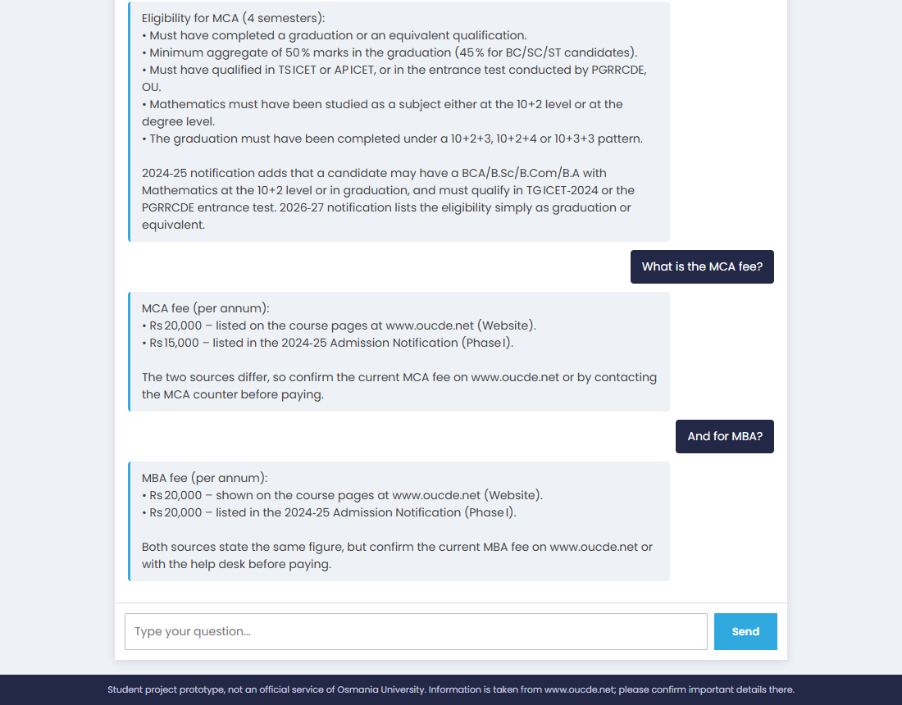

# PGRRCDE Enquiry Chatbot

A chat page where students and parents can ask questions about **Prof. G. Ram Reddy Centre for Distance Education (PGRRCDE), Osmania University** and get instant answers: admissions, courses, eligibility, fees, exams, classes and contact details.

> **Student project prototype.** It is not an official service of Osmania University. The information was collected from the official website (www.oucde.net) in November 2026 and can go out of date. Always confirm important details on the official website.



---

## 1. What is this, in plain words?

Imagine a helpful office assistant who has read the college's information booklet and who never sleeps. You type a question like *"What is the MCA fee?"* and the assistant answers in a few seconds, in normal English.

That assistant is this project. It has three parts:

| Part | Everyday comparison | What it really is |
|---|---|---|
| **The chat page** | The reception desk where you talk | A web page (built with **React**) |
| **The brain** | An assistant who reads the booklet and writes the answer | An **AI language model** (see the glossary below) |
| **The booklet** | The college information the assistant is allowed to use | A **PDF file** (`PGRRCDE_College_Information.pdf`) |

Between the page and the brain sits a small program, the **backend** (written in Python with **Flask**), which acts like a messenger: it takes your question, finds the right pages of the booklet, hands both to the brain, and brings the answer back to the page.

### What happens when you ask a question

```
 You type a question
        |
        v
 [Chat page]  --->  [Backend messenger]  --->  [Booklet PDF]
                          |                    "find the 6 most relevant paragraphs"
                          v
                 [AI language model]
                 "answer ONLY from these paragraphs"
                          |
                          v
 You read the answer  <---  [Chat page]  <---  [Backend messenger]
```

Because the assistant is told to answer **only** from the booklet, it says *"I don't have that information, please contact the college office"* instead of making things up when you ask about something else (for example cricket).

---

## 2. Words you may have heard (mini glossary)

- **AI language model (LLM)**: a computer program trained on a huge amount of text so that it can read a question and write a sensible answer. ChatGPT is a famous example. This project uses an **open-source** one, which means its design is published and anyone may use it for free.
- **Cloud / hosted model**: instead of running the AI on your own laptop (which needs a strong computer), you "rent" it over the internet. This project uses a free service called **Groq** for that. Your laptop only sends the question and receives the answer.
- **Local model**: the AI runs on your own computer using a free tool called **Ollama**. No internet is needed, but it needs a decent computer and a 2 GB download.
- **API key**: like a password that tells Groq "this request comes from my free account". Keep it private.
- **Backend / frontend**: the frontend is what you see (the chat page). The backend is the hidden helper that does the work.
- **PDF "knowledge base"**: the document the assistant is allowed to read. Change the PDF and the assistant's knowledge changes. No programming is needed.
- **Hallucination**: when an AI confidently says something untrue. This project reduces it by forcing answers to come from the PDF.

---

## 3. What you need before you start

- A Windows, Mac or Linux computer with internet.
- **Python 3** (https://www.python.org/downloads/). Tick "Add Python to PATH" while installing.
- **Node.js** (https://nodejs.org/), the LTS version.
- A **free Groq account and API key** (https://console.groq.com, sign up, then "API Keys", then "Create API Key").
  *Prefer no account at all? See "Using a local model" in section 6.*

---

## 4. Setup, step by step (Windows)

Open **PowerShell** and go to the project folder (the one that contains this README).

**Step 1: Give the project your Groq key**

Copy `backend/.env.example` to a new file called `backend/.env` and put your own key in it:

```
GROQ_API_KEY=paste_your_key_here
```

This `.env` file is private and is never uploaded to GitHub.

**Step 2: Start the backend (the messenger)**

```powershell
python -m venv .venv
.venv\Scripts\activate
cd backend
python -m pip install -r requirements-dev.txt
python app.py
```

Leave this window open. It should say it is running on port 5000.

**Step 3: Start the chat page**

Open a **second** PowerShell window:

```powershell
cd frontend
npm install
npm run dev
```

**Step 4: Open the chatbot**

Go to **http://localhost:5173** in Google Chrome. Click a suggested question or type your own.

*(Mac/Linux: activate the virtual environment with `source .venv/bin/activate` instead.)*

---

## 5. Using it

- Click one of the four example questions, or type your own and press **Enter**.
- Follow-up questions work: ask *"What is the MCA fee?"* then simply *"And for MBA?"*
- If the website and an official notice disagree (for example on a fee), the chatbot tells you **both** numbers and where each came from.

---

## 6. Common tasks

### Update the college information
The assistant only knows what is in `backend/knowledge/PGRRCDE_College_Information.pdf`.

- Replace that file with a newer PDF (it must contain real text, not scanned pictures), **or**
- With the backend running, send a new PDF to `POST http://localhost:5000/api/knowledge` (form field name `file`).

The next question automatically uses the new PDF. No restart is needed.

### Using a local model instead of Groq (no account, works offline)
1. Install Ollama from https://ollama.com.
2. Run `ollama pull llama3.2:3b` (about 2 GB).
3. Remove the `GROQ_API_KEY` line from `backend/.env` (or delete the file) and restart the backend.

The project uses Groq when a key is present and Ollama when it is not.

### Change the AI model
Add `GROQ_MODEL=model_name` to `backend/.env` (default is `openai/gpt-oss-20b`). Model names offered by Groq change over time.

### Run the automated tests
```powershell
cd backend
..\.venv\Scripts\python -m pytest -v        # about a minute (some tests talk to the real AI)
cd ..\frontend
npm test
```
Currently 32 backend tests and 7 frontend tests pass. The tests that use the real AI are skipped automatically if there is no key.

---

## 7. If something goes wrong

| What you see | What it means | What to do |
|---|---|---|
| "Error: backend not reachable." | The backend window is not running | Start it (Step 2) |
| "Cannot reach the model server..." | No Groq key found and Ollama is not running | Check `backend/.env`, or start Ollama |
| "The model is busy (rate limit reached)..." | The free plan allows only a few questions per minute | Wait about 30 seconds and ask again |
| Error 401 | Wrong or missing key | Re-copy the key into `backend/.env` |
| Error 404 from groq | The AI model name was retired | Set `GROQ_MODEL` to a current one |
| Blank page | The chat page is not running | Run `npm install` then `npm run dev` |

---

## 8. What is inside the folders

```
chatbot/
  backend/
    app.py                     The messenger: reads the PDF, asks the AI, returns the answer
    knowledge/
      PGRRCDE_College_Information.pdf   The booklet (the assistant's only source of facts)
    tests/                     Automated checks for the backend
    requirements.txt           Python packages needed
    .env.example               Template for your private key file
  frontend/
    src/App.js                 The main chat page
    src/components/            Small building blocks: Header, ChatWindow, Message, ChatInput, Suggestions
    src/App.test.js            Automated checks for the page
  docs/screenshots/            Pictures of the running app
```

---

## 9. Good to know (limits and privacy)

- The AI can still occasionally give an imperfect answer. That is why the project tells it to quote the PDF and to advise confirming on the website.
- With **Groq**, the text of each question is sent to Groq's servers over the internet. Do not type personal details such as phone numbers or ID numbers. With **Ollama**, everything stays on your computer.
- The "replace the PDF" feature has no password in this prototype. Do not put it on the public internet as it is.
- The free Groq plan limits how many questions you can ask per minute.

---

## 10. Technology used

React 18 and Vite (chat page), Python and Flask (backend), pypdf (reads the PDF), Groq-hosted `openai/gpt-oss-20b` or Ollama `llama3.2:3b` (language model), pytest and Vitest (tests).

## 11. Credits

College information: public pages and notifications of www.oucde.net and www.osmania.ac.in (PGRRCDE, Osmania University). Built as an MCA mini project. This is an independent student work; the university's name and information belong to the university.
